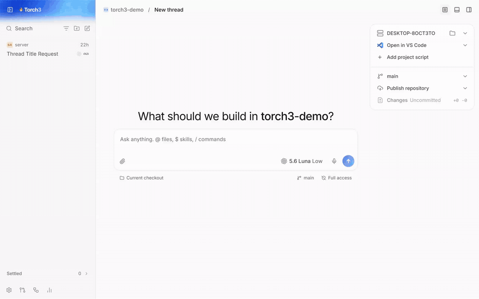
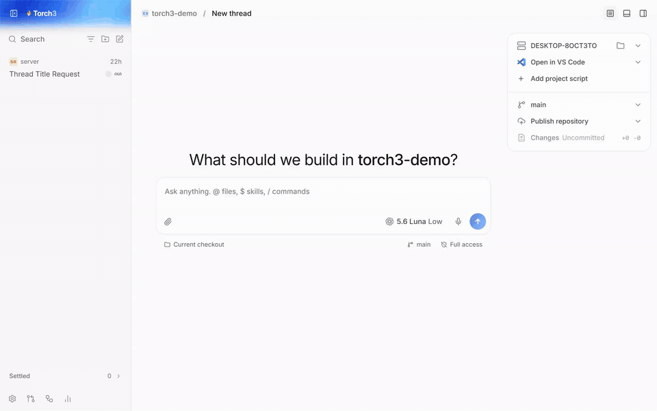

<p align="center">
  
</p>

<h1 align="center">Torch3</h1>

<p align="center">One prompt, a whole team of coding agents.<br/>
A fork of <a href="https://github.com/pingdotgg/t3code">T3 Code</a> with
<a href="https://github.com/oxgeneral/ORCH">ORCH</a> multi-agent orchestration built in.</p>

<p align="center">
  <a href="https://www.npmjs.com/package/torch3"></a>
  <a href="https://github.com/SpaceDogA1/torch3/releases/latest"></a>
  <a href="./LICENSE"></a>
</p>

<p align="center">
  <a href="./docs/user/install.md"><strong>Install</strong></a> ·
  <a href="./docs/user/orchestry.md"><strong>Orchestry guide</strong></a> ·
  <a href="./docs/README.md">Docs</a> ·
  <a href="./CONTRIBUTING.md">Contributing</a>
</p>

<p align="center">
  
</p>

Torch3 is T3 Code, the open-source control plane for coding agents, plus **Orchestry**: ORCH built
in, so a team of agents can work on one project in parallel. T3 stays the interface, auth, transport
and owner of your checkout. ORCH runs the agents, tasks, goals and teams.

It works with the agents you already pay for: Claude Code, Codex, Cursor, OpenCode, Grok Build,
Antigravity, Kiro, Pi, Muse Code, fx, and any [ACP](./docs/user/providers-acp.md) agent.

## Install

```sh
npx torch3
```

That starts Torch3 and opens it in your browser. Node.js 22.16 or newer is required. To keep the
command around, run `npm install --global torch3`.

Desktop installers for macOS (Apple Silicon), Windows and Linux are on the
[releases page](https://github.com/SpaceDogA1/torch3/releases/latest). They are not code-signed yet:

- **macOS:** right-click the app, choose **Open**, then confirm once.
- **Windows:** in the SmartScreen prompt, select **More info**, then **Run anyway**.

Torch3 keeps its data in `~/.torch3`, so it runs beside an installed T3 Code without sharing
threads, settings or sign-ins. See the [install guide](./docs/user/install.md) for details.

## Orchestry

- **Per-project teams.** Turn Orchestry on for a project, add agents and queue tasks. Each agent
  works in its own Git worktree.
- **Your checkout stays yours.** ORCH merges into a separate `t3-orchestry/<project>` integration
  branch. You review the diff and merge it into your branch yourself.
- **Queue from anywhere.** Open Orchestry from the sidebar, the command palette or a project's
  right-click menu, or send `/orch <task>` from any thread.
- **Safe by default.** ORCH runs in worktree mode only, never updates itself and never runs its
  install script. Projects that cannot run ORCH say why before you enable it.
- **Reachable by agents.** Orchestry's reads and actions are `orchestry_` MCP tools.

<p align="center">
  
</p>

A project needs to be the root of its own Git repository with at least one commit. ORCH agents need
one agent CLI installed and signed in, for example `claude auth login` or `codex login`. Read the
[Orchestry guide](./docs/user/orchestry.md) to get started, and the
[integration notes](./docs/internals/orchestry.md) for how it is built.

## Status

| Area                   | State                                                                |
| ---------------------- | -------------------------------------------------------------------- |
| Web app and `torch3`   | npm package `torch3`, also attached to each release                  |
| Orchestry              | Server, web and MCP tools, tested                                    |
| Desktop app            | Unsigned installers; Windows and Linux update themselves             |
| Mobile app             | Not available; T3 Code's app does not connect to Torch3              |
| Upstream-only services | T3 Connect, the hosted app and in-app updates are not part of Torch3 |

[TORCH3.md](./TORCH3.md) lists what still behaves as upstream does.

## Develop

```sh
vp i
vp run dev
```

`vp` comes from [Vite+](https://viteplus.dev/guide/) and provides the pinned Node version. Read
[CONTRIBUTING.md](./CONTRIBUTING.md) and the
[development runbook](./docs/operations/development.md) before your first change.

## Credits

Torch3 is built on [T3 Code](https://t3.codes) by the T3 team and
[ORCH](https://github.com/oxgeneral/ORCH) by oxgeneral.

## License

[MIT](./LICENSE)
